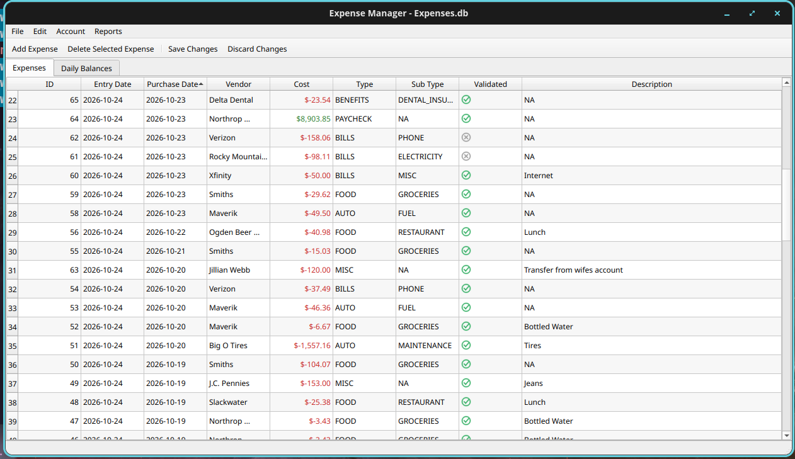
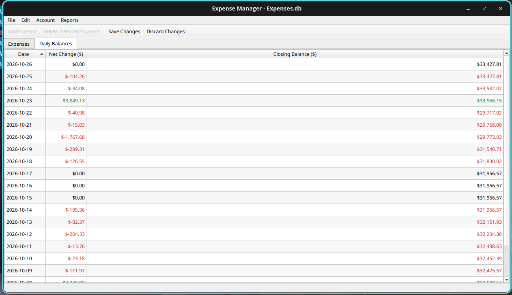
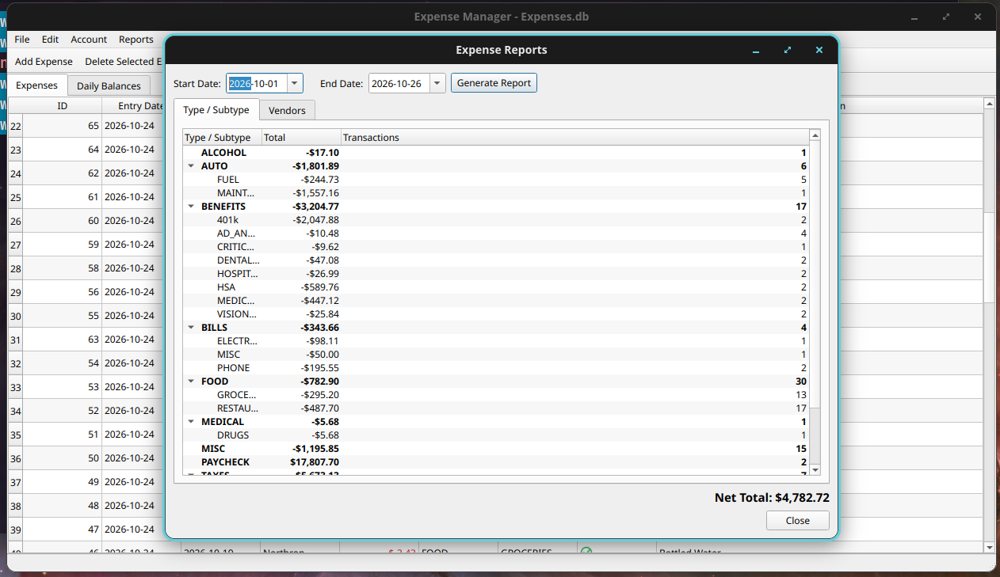
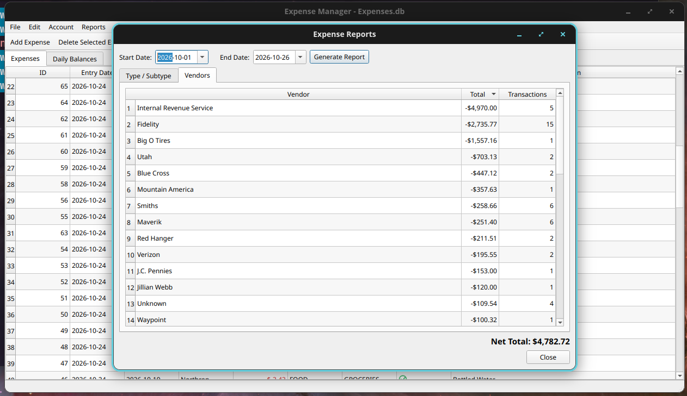

===============
expense_manager
===============

A desktop application for recording personal income and expenses, tracking a
checking-account balance, and reviewing spending by category or vendor.
``expense_manager`` uses Python, PyQt6, and SQLite to provide a spreadsheet-like
interface without requiring an online financial service.

.. image:: https://img.shields.io/badge/code%20style-black-000000.svg
   :target: https://github.com/psf/black
   :alt: Black code style

.. image:: https://img.shields.io/badge/imports-isort-%231674b1?style=flat&labelColor=ef8336
   :target: https://pycqa.github.io/isort/
   :alt: isort imports

.. image:: https://img.shields.io/badge/lint-flake8-blue.svg
   :target: https://flake8.pycqa.org/
   :alt: flake8 linting

.. image:: https://img.shields.io/badge/types-mypy-blue.svg
   :target: https://mypy-lang.org/
   :alt: mypy type checking

.. image:: https://img.shields.io/badge/database-SQLite-003B57.svg
   :target: https://www.sqlite.org/
   :alt: SQLite database

Repository: https://github.com/Jon-Webb-79/expense_manager

Overview
========

``expense_manager`` is a local personal-finance ledger. Transactions are
stored in an SQLite database, with monetary amounts represented internally as
integer cents. Expenses are negative amounts; income, refunds, and other
credits are positive amounts.

The application combines an editable transaction register, a calculated daily
account balance, and interactive expense reports. All information remains in
the SQLite database selected by the user.

Features
========

* **Expense register:** Add, edit, delete, sort, and review transactions in a
  spreadsheet-like table. Each record includes entry date, purchase date,
  vendor, amount, category, subcategory, validation status, and description.
* **Transaction filtering:** Filter expenses by purchase-date range, vendor,
  category, or subcategory using the column-header menus.
* **Account configuration:** Set an account name, tracking start date, and
  opening balance.
* **Daily balances:** View each calendar day's net change and closing balance,
  including dates with no transactions. Balances are recalculated when the
  database is opened, transactions are saved, or account settings change.
* **Visual indicators:** Negative amounts appear in red, positive amounts in
  green, and zero changes use the default text color.
* **Expense reports:** Summarize transactions for a selected date range by
  category/subcategory or by vendor, including totals and transaction counts.
* **Local persistence:** Create, open, and validate SQLite databases. Changes
  to the expense register can be saved or discarded.
* **Automated testing:** Unit tests cover database behavior and application
  models.

Screenshots
===========

Expense Register
----------------

The Expenses tab provides a sortable, editable transaction ledger with
color-coded amounts and validation indicators.

Daily Balances
--------------

The Daily Balances tab shows the net change and closing account balance for
each date. Red indicates a decrease and green indicates an increase.

Reports by Category and Subcategory
-----------------------------------

Select a date range to review grouped totals and transaction counts.

Reports by Vendor
-----------------

The vendor report groups transactions by payee and displays total amounts and
transaction counts for the selected period.

.. note::

   These image paths are relative to ``README.rst``. Keep the four PNG files
   alongside the README in the repository so GitHub can display them.
   Screenshots may contain personal financial information; review or redact
   them before publishing to a public repository.

Project Structure
=================

The application separates database access, expense models, the graphical
interface, and controller logic::

   expense_manager/
   ├── expense_manager/
   │   ├── controllers/
   │   │   └── expense_controller.py
   │   ├── database/
   │   │   ├── account_repository.py
   │   │   ├── connection.py
   │   │   ├── repository.py
   │   │   ├── schema.py
   │   │   └── validation.py
   │   ├── models/
   │   │   ├── daily_balance_table_model.py
   │   │   ├── expense.py
   │   │   ├── expense_filter_proxy_model.py
   │   │   └── expense_table_model.py
   │   └── views/
   │       ├── account_settings_dialog.py
   │       ├── delegates.py
   │       ├── expense_dialog.py
   │       ├── expense_filter_dialogs.py
   │       └── main_window.py
   ├── tests/
   ├── pyproject.toml
   ├── poetry.lock                 # If committed to the repository
   └── README.rst

Requirements
============

* Python compatible with the version specified in ``pyproject.toml``
* Poetry for dependency and virtual-environment management
* A desktop environment capable of running PyQt6
* SQLite (accessed through Python's standard-library ``sqlite3`` module)

The authoritative list of package dependencies and development tools is in
``pyproject.toml``.

Installation
============

Clone the repository::

   git clone https://github.com/Jon-Webb-79/expense_manager.git
   cd expense_manager

Install dependencies with Poetry::

   poetry install

Run the application using the entry point configured in ``pyproject.toml``.
If no console-script entry point is defined, use the project's existing
application-launch module or script.

Using the Application
=====================

1. Select **File > New Database** to create a database, or **File > Open
   Database** to open an existing one.
2. Select **Account > Account Settings** to configure the account name,
   starting date, and opening balance.
3. Use the **Expenses** tab to enter transactions. Record withdrawals and
   purchases as negative amounts, and deposits or credits as positive amounts.
4. Select **Save Changes** to persist edited transactions. Daily balances are
   recalculated from the saved expense records.
5. Open the **Daily Balances** tab to review the account's daily net changes
   and closing balances.
6. Select **Reports > Expense Summary** to review spending by category,
   subcategory, or vendor over a chosen date range.

.. note::

   Daily balances are derived from the account's opening balance and recorded
   transactions. They are not independently entered transactions. Future-dated
   expenses are not included in balances calculated only through the current
   date.

Development
===========

Run the test suite::

   poetry run pytest

Run formatting and static-analysis tools if installed in the Poetry
environment::

   poetry run black .
   poetry run isort .
   poetry run flake8
   poetry run mypy .

The project uses a separation of responsibilities:

* **Database layer:** SQLite schema, integrity checks, expense persistence,
  account settings, and daily-balance calculations.
* **Models:** Expense records and Qt table models, including filtering,
  sorting, formatting, and editable-cell behavior.
* **Views:** PyQt6 windows, tables, dialogs, and delegates.
* **Controller:** Coordinates database operations, user actions, and model
  refreshes.

Data and Backups
================

SQLite database files contain the user's financial records. They should be
backed up regularly and should not be committed to a public repository.
Consider adding the following patterns to ``.gitignore``::

   *.db
   *.db-shm
   *.db-wal

When importing records from an older database, back up the destination first.
Import transactions into the expense table and allow the application to
recalculate the daily-balance table.

Future Work
===========

Potential improvements include:

* Date-range filtering for the Daily Balances tab.
* Exporting expense reports and daily balances to CSV or Excel.
* Additional account and transaction reconciliation tools.
* Improved handling of historical database-schema migrations.
* Expanded automated GUI and integration tests.

Contributing
============

Issues and pull requests are welcome at
https://github.com/Jon-Webb-79/expense_manager.

When contributing, please add or update relevant tests, keep code formatted,
and document changes to database behavior or the user interface.

License
=======

See the repository's ``LICENSE`` file for the applicable license terms.
